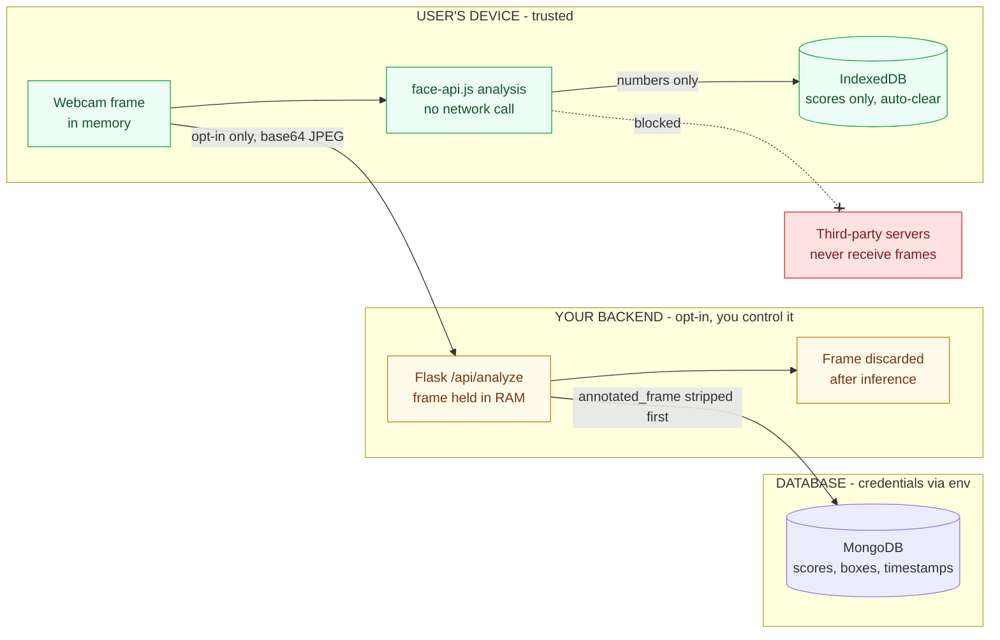

# 🔐 Security and Privacy

Facial data is sensitive. This document states what happens to a face once it is captured, which protections the code provides, and what to harden before using this with real participants.

**Contents:** [Summary](#1-summary) · [Data flow](#2-data-flow) · [Client-only mode](#3-client-only-mode) · [Backend mode](#4-backend-mode) · [Local storage](#5-local-storage) · [Secrets](#6-secrets) · [Threat model](#7-threat-model) · [Hardening](#8-hardening-checklist) · [Consent](#9-consent-and-responsible-use) · [Reporting](#10-reporting-a-vulnerability)

---

## 1. Summary

| Mode | Where the face goes | What is stored |
|---|---|---|
| **Browser-only** (default) | Nowhere. Analysis is on-device. | Scores in your own browser |
| **Backend** (opt-in) | To your Flask server, in memory, once per frame | Scores, boxes, timestamps in MongoDB. **No images.** |

> ⚠️ The shipped backend configuration is tuned for **local development**. Do not expose it to an open network until you have worked through [section 8](#8-hardening-checklist).

---

## 2. Data Flow

---

## 3. Client-only Mode

This is the default, and it is what runs whenever no backend is configured or reachable.

- Analysis runs in the browser through `face-engine.js` (face-api.js on TensorFlow.js).
- The webcam stream goes to a `<canvas>` and is never transmitted.
- The only requests made are for model weights and fonts from CDNs. Neither receives user data.

This is the strongest privacy posture the app offers.

---

## 4. Backend Mode

The backend is used only when it is configured, reachable, and preferred.

| Item | Sent to backend | Persisted |
|---|---|---|
| Raw frame | ✅ base64 JPEG per analysed frame | ❌ Decoded in memory, used for one inference pass, discarded |
| Annotated preview image | Returned to the requesting client | ❌ `annotated_frame` is removed before the MongoDB write and excluded from every read and export query |
| Emotion scores, boxes, confidence, timestamps | Returned to the client | ✅ Stored as numeric metadata |
| Participant ID | Supplied by the client | ✅ Stored for session grouping |

**Net effect:** the backend writes no facial imagery to persistent storage. The one in-memory exception is a `session_store` dictionary used to serve the *current* frame back to the client. It is not persisted and is overwritten by the next frame.

---

## 5. Local Storage

- **IndexedDB (`EmotiDB`)** holds session summaries and per-frame results on the user's device only.
- **Settings → Privacy** exposes `autoClearHistory` and `historyRetention` (default 7 days) so the user controls how long local history survives.
- Browser storage is scoped to the browser profile. Clearing site data removes it.

---

## 6. Secrets

- `MONGO_URI` is read from the environment, never hard-coded.
- `.env` is git-ignored. Commit only `.env.example`, which must contain no real credentials.
- Uploaded filenames pass through `secure_filename()` before touching disk.

If a credential is ever committed by accident, treat it as compromised and **rotate it**. Removing it from git history is not enough.

---

## 7. Threat Model

| Threat | Mode | Current mitigation | Residual risk |
|---|---|---|---|
| Frames sent to third parties | Both | None are sent | Low |
| Frame retained on server | Backend | Memory-only, discarded | Low |
| Imagery leaking via database | Backend | `annotated_frame` stripped on write and read | Low |
| Credential leak from repo | Backend | Env vars, `.env` ignored | Medium if `.env` is ever committed |
| Unauthorised use of the API | Backend | **None by default** | **High** if exposed |
| Cross-origin abuse of the API | Backend | CORS configured, but see below | **High** if exposed |
| Eavesdropping on frames in transit | Backend | None in local dev (`http://`) | **High** on untrusted networks |
| Path traversal via upload name | Backend | `secure_filename()` | Low |
| Tampered model weights from CDN | Client | None | Low to medium |
| Another person using the device | Both | Auto-clear and retention settings | Medium on shared machines |

---

## 8. Hardening Checklist

Work through this before any deployment beyond `localhost`.

| ☐ | Gap | Why it matters | Fix |
|---|---|---|---|
| ☐ | `CORS(app, origins=["*", ...])` | The `"*"` wildcard makes the specific origin pointless. Any website can drive your backend from a visitor's browser. | List only your real frontend origin(s). Remove `"*"`. |
| ☐ | No authentication on `/api/*` | Anyone who can reach the server can submit frames or read history. | Require an API key or token on every route. |
| ☐ | Plain HTTP | Frames and results are readable on the network path. | Terminate TLS at a reverse proxy with a valid certificate. |
| ☐ | Broad MongoDB access | A leaked URI exposes all history. | Atlas IP allow-list, least-privilege DB user, rotate credentials. |
| ☐ | No per-person deletion | Participants cannot remove their own history. | Add a "delete my participant data" endpoint. |
| ☐ | CDN-hosted model files | A compromised CDN could serve altered weights. | Self-host the face-api.js models, and use Subresource Integrity where possible. |
| ☐ | No rate limiting | One client can exhaust the server. | Add per-IP or per-key limits on `/api/analyze`. |
| ☐ | Debug mode | Flask debug exposes an interactive console. | Never run with `debug=True` outside local use. |

---

## 9. Consent and Responsible Use

Technical controls are not enough on their own, because this tool analyses people's faces.

- **Get explicit consent** from every participant before analysis starts, and tell them what is measured and where it goes.
- **Do not use it for high-stakes decisions** such as hiring, grading, discipline or monitoring employees. Expression recognition is an unreliable proxy for inner state and its accuracy varies across people.
- **Keep it voluntary.** Participants should be able to opt out without penalty.
- **Check local law.** Biometric and emotion-inference rules differ by jurisdiction (for example, some regulations restrict emotion recognition in workplaces and schools).
- **Minimise retention.** Use auto-clear, and delete session data you no longer need.

---

## 10. Reporting a Vulnerability

Please do not open a public issue for a security problem. Contact the maintainer privately through the GitHub profile at [github.com/Deep455-16](https://github.com/Deep455-16) with a description and reproduction steps. Expect an acknowledgement, and allow reasonable time to fix before disclosing.
